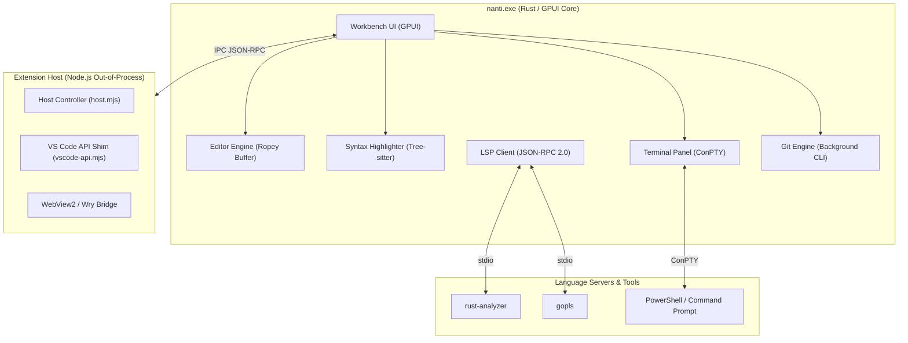

<div align="center">
  
  <h1>nanti</h1>
  <p><strong>Code now. Not later.</strong></p>
  <p><em>An ultra-lightweight, zero-telemetry, local-first code editor built natively in Rust for Windows.</em></p>

  <p>
    <a href="LICENSE"></a>
    
    
    
    
  </p>
</div>

---

## Overview

**`nanti`** is an ultra-fast, native desktop code editor and developer environment built from the ground up in Rust. `nanti` is centered on two fundamental engineering commitments: **Absolute Privacy (Zero Telemetry)** and **Featherweight Native Performance**.

---

## Core Engineering Pillars

### 1. Absolute Privacy & Local-First Processing
- **Strictly Zero Telemetry:** `nanti.` collects **no metrics, no telemetry pings, no usage analytics, and no crash beacons**. It never phones home.
- **Data Sovereignty:** Your source code, open files, keystrokes, Git credentials, and terminal command history **never leave your machine**.
- **Transparent & Auditable:** 100% open-source under the MIT license with clean-room architecture. Every network and IPC boundary is transparent and inspectable.
- **Explicit Consent Isolation:** Out-of-process extensions are sandboxed; any external URL navigation (`env.openExternal`) prompts the user for explicit confirmation before executing.

### 2. Featherweight Native Architecture
- **Instant Cold Start (< 100 ms):** Launches immediately upon invocation—no splash screens, no loading spinners, and no framework startup delays.
- **Tiny Memory Footprint (~40–70 MB RAM):** Idles at under 70 MB of RAM, leaving maximum system memory available for your compilers, containers, and tools.
- **Native GPU Rendering (60fps):** Directly driven by hardware-accelerated GPUI engine (DirectX / Vulkan on Windows). Smooth typing and scrolling with zero web-DOM layout overhead.
- **Zero CPU at Idle:** GPU repaints only occur when content is modified or animations are active. Conserves battery life on laptops.
- **Compact Standalone Binary:** The entire release executable is a compact single file (`~23 MB`).

---

## Architecture



---

## Key Features

### Ultra-Fast Native Core
- Starts in under **100 ms** and uses **~40–70 MB RAM** at idle.
- UTF-8 and CRLF line ending preservation with piece-tree/rope data structures (`ropey`).
- Atomic file writes (temporary file + rename) with external modification conflict detection.

### Language Intelligence & Syntax
- **Tree-sitter Grammars:** Built-in syntax highlighting for 35 languages: Rust, TypeScript/TSX, JavaScript, Go, JSON, Dart, Markdown, Python, C, C++, C#, Java, Ruby, PHP, HTML, CSS, YAML, TOML, Bash, PowerShell, Lua, SQL, XML, Make, CMake, Batch, INI, Properties, Diff, R, Zig, Elixir, Erlang and Nix. A grammar is loaded only when a file of that language is opened.
- **Live LSP Diagnostics:** Connected to native language servers (`rust-analyzer`, `gopls`) with real-time squiggle underlines and line-number error markers.
- **Problems Panel:** Dedicated tab aggregating syntax and semantic diagnostics across open files.

### ConPTY Integrated Terminal
- Full Windows ConPTY backend launching PowerShell or custom shells.
- Vertical side-tabs for switching between multiple concurrent terminal sessions.
- Process exit code tracking, clean interrupt (`Ctrl+C`), and IME composition pre-edit display.

### Extension Compatibility & Open VSX
- Out-of-process Node.js runtime executing extension logic in the background.
- Direct search against the **Open VSX Marketplace** with one-click download and automated `.vsix` extraction.
- Local `.vsix` package installation via native Windows file dialogs.
- Sandboxed WebView2 webview panels for rich extension interfaces.

### Search, Navigation & Command Palette
- **Fuzzy Quick Open (`Ctrl+P`):** Fast file indexing across repositories.
- **Command Palette (`Ctrl+Shift+P`):** Instant access to every IDE action.
- **Fast Find & Replace (`Ctrl+F` / `Ctrl+H`):** Regex support, match highlighting, and case/whole-word toggling.
- **Workspace Search (`Ctrl+Shift+F`):** Rapid multi-file regex search grouped by file.

### Editing Helpers
- **Format Document (`Shift+Alt+F`) and format on save:** rustfmt, gofmt, `dart format` and Prettier (the project's own, the one inside the Prettier extension, or one on PATH). On by default, switch it in Settings. A formatter error never blocks a save.
- **Right-click menus** in the editor and on tabs, with cut, copy, paste, rename in file, format and the command palette.
- **HTML shortcuts:** `!` then `Tab` writes an HTML5 page; `ul>li*3`, `div.box`, `a` and similar abbreviations expand on `Tab` in `.html`, `.htm`, `.vue` and `.svelte` files. Built in, no extension needed.

### Discord Rich Presence (not in 1.0.0)
- The code is in the tree but left out of the 1.0.0 build: nothing in Settings, no palette commands, no connection to Discord. Build with `cargo build --release --features discord` to try it.

### Modern Dark Theme
- Tailored dark palette (`#181818` / `#1e1e1e`) with clean borders and subtle contrast.
- Subtle active line highlight (`rgba(255, 255, 255, 0.04)`) and highlighted active line numbers.
- Embedded SVG vector icons for activity bar, explorer items, and layout controls.

---

## Getting Started

### Prerequisites
- **Operating System:** Windows 10 / 11 (64-bit)
- **Rust Toolchain:** Stable MSVC (`stable-x86_64-pc-windows-msvc`), managed by `rust-toolchain.toml`
- **Build Tools:** Visual Studio C++ Build Tools & Windows SDK
- **Node.js:** Node.js >= 20 (for the out-of-process extension host)
- **Git:** Git for Windows (accessible on `PATH`)

### Building from Source

1. **Clone the repository:**
   ```sh
   git clone https://github.com/theepar/nanti-ide.git
   cd nanti-ide
   ```

2. **Verify tests and environment:**
   ```sh
   cargo test --workspace
   cd extension-host && npm test && cd ..
   ```

3. **Run in development mode:**
   ```sh
   cargo run -p ui
   ```

4. **Build optimized release binary:**
   ```sh
   cargo build --release -p ui
   ```
   The standalone executable will be located at `target/release/nanti.exe`.

---

## Keyboard Shortcuts

| Shortcut | Command | Action |
|---|---|---|
| `Ctrl+P` | **Quick Open** | Fuzzy search and open workspace files |
| `Ctrl+Shift+P` | **Command Palette** | Access all workbench commands |
| `Ctrl+S` | **Save** | Save active editor buffer |
| `Ctrl+Shift+S` | **Save All** | Save all modified buffers |
| `Ctrl+W` | **Close Tab** | Close active editor tab |
| `Ctrl+Shift+W` | **Close All Tabs** | Close all open tabs (prompts if dirty) |
| `Ctrl+F` | **Find** | Open find bar in active editor |
| `Ctrl+H` | **Replace** | Open find and replace bar |
| `Ctrl+Shift+F` | **Search in Files** | Open workspace search sidebar |
| `Ctrl+\`` | **Toggle Terminal** | Show / hide integrated terminal panel |
| `Ctrl+B` | **Toggle Sidebar** | Show / hide activity sidebar |
| `Ctrl+J` | **Toggle Panel** | Show / hide bottom panel |
| `Ctrl+Shift+M` | **Maximize Panel** | Maximize / restore bottom panel |
| `Ctrl+/` | **Toggle Comment** | Comment or uncomment selected lines |
| `Alt+Up` / `Alt+Down` | **Move Line** | Move selected line(s) up or down |
| `Ctrl+G` | **Go to Line** | Jump directly to line and column |

---

## Workspace Configuration

`nanti.` supports the following environment variables:

| Variable | Description |
|---|---|
| `NANTI_WORKSPACE` | Path to the default workspace root folder |
| `NANTI_EXTENSION` | Path to an unpacked extension directory for testing |
| `NANTI_VIEW` | Webview view identifier to bind to the extension panel (shown as a tab in the editor area) |
| `NANTI_NODE` | Custom path to the Node.js binary (defaults to `node` on `PATH`) |
| `NANTI_CONFIG_DIR` | Custom directory for user preferences and layout state |

User settings and window layout states are automatically persisted across sessions in `%APPDATA%\nanti\layout.json`.

---

## Workspace Crates

The repository is organized as a Cargo workspace with distinct responsibilities:

- **`crates/ui`**: Workbench shell, GPUI rendering, menus, tabs, theme, and picker integration.
- **`crates/editor-core`**: Core text rope buffer, cursor arithmetic, selections, and undo/redo stacks.
- **`crates/syntax`**: Tree-sitter parsers, highlights, and symbol outline extraction.
- **`crates/terminal`**: ConPTY session management and terminal emulator state.
- **`crates/git`**: Asynchronous background Git status, diff parser, and staging operations.
- **`crates/app`**: Native process management and IPC client for the extension host.
- **`extension-host`**: Node.js worker implementing the VS Code extension API shim.

---

## Legal, Trademarks & DMCA Compliance

`nanti.` is licensed under the [MIT License](LICENSE).

All bundled components and dependencies are open source and used in compliance with their respective licenses:
- [LEGAL.md](LEGAL.md) — Comprehensive trademark policy, nominative fair use doctrine, marketplace compliance, and DMCA takedown procedures.
- [THIRD_PARTY_NOTICES.md](THIRD_PARTY_NOTICES.md) — Dependency license catalog (800+ crates).
- [THIRD_PARTY_LICENSES.txt](THIRD_PARTY_LICENSES.txt) — Verbatim third-party license texts.
- [docs/legal-compliance.md](docs/legal-compliance.md) — Contributor originality guidelines and clean-room implementation records.

### Trademark Notice & Disclaimers
- "Visual Studio Code" and "VS Code" are registered trademarks of **Microsoft Corporation**.

`nanti.` is an independent open-source project and is **not affiliated with, sponsored by, or endorsed by Microsoft**. Any references to "Visual Studio Code", "VS Code", or extension APIs are made strictly for technical compatibility and identification purposes under the legal doctrine of **Nominative Fair Use**. `nanti.` connects exclusively to the Eclipse Foundation's **Open VSX Registry** and does not access or redistribute software from the Microsoft Visual Studio Marketplace.

For DMCA inquiries or copyright notifications, please consult [LEGAL.md](LEGAL.md) or contact `legal@nanti.dev`.
